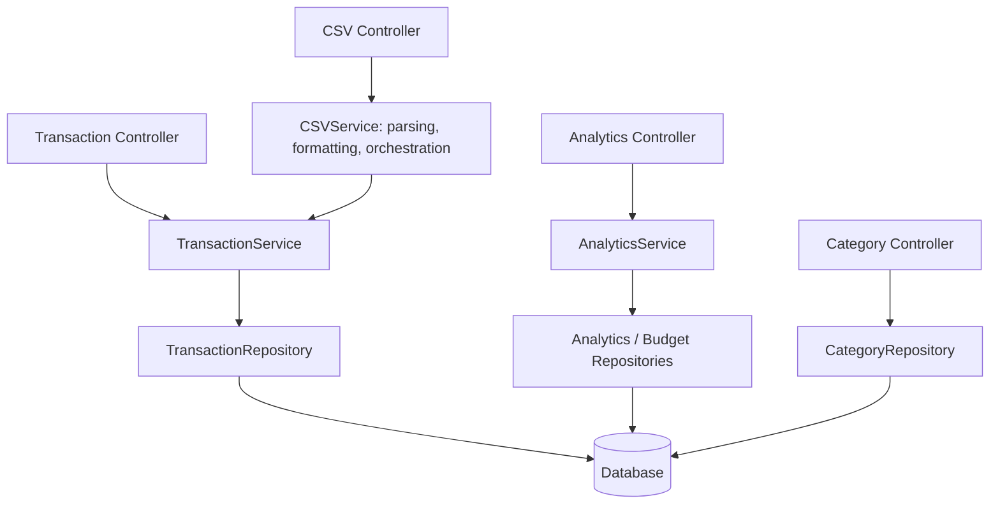
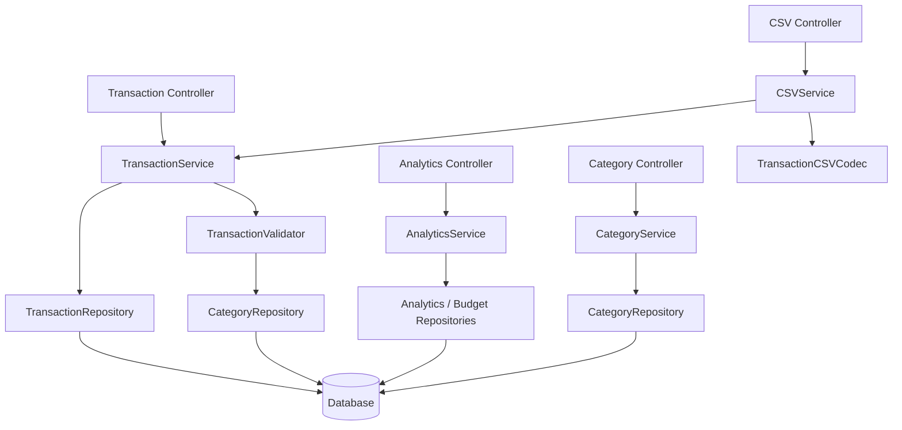

# Assignment 02 — Engineering Implementation Notes

## Before and after architecture

The Assignment 01 code already routed Add Expense and Monthly Budget Summary through services and repositories. The main bypass found during review was category listing, where the route instantiated a repository directly. CSV import/export also combined CSV-format conversion and use-case orchestration in one service.

**Before**



**After**



The refactored feature paths include Add Expense (validation separated from use-case orchestration) and CSV import/export (format conversion separated from application orchestration). Category listing was additionally corrected to follow Controller → Service → Repository → Database. Monthly Budget Summary already followed the required layers in the Assignment 01 baseline and remains on that path.

## Selected rewrites

- `TransactionService` delegates reusable transaction input and category rules to `TransactionValidator`, leaving the service to coordinate transaction use cases and monthly-income policy.
- `CSVService` coordinates import/export through `TransactionCSVCodec`; the codec owns CSV serialization, parsing, header validation, and row conversion.

The CSV wire format remains `type, amount, date, description, category_id`.

## Migration

The migration path is SQLite to PostgreSQL. Local development continues to default to SQLite; Docker Compose provisions PostgreSQL 17. The migration utility requires an empty destination, copies mapped tables in SQLAlchemy dependency order, preserves primary keys, resets PostgreSQL serial sequences, and leaves the SQLite source unchanged.

The migration service supports both source layouts used by earlier versions:

**Existing Docker Compose installation using a named volume**

1. Run `docker volume ls` and identify the old SQLite volume. With the previous Compose project name `expensemate`, its usual name is `expensemate_expensemate-data`.
2. Back up the volume before migration. For example, replace the volume name below with the exact name from `docker volume ls`:
   `docker run --rm -v expensemate_expensemate-data:/source:ro -v "$PWD/backups":/backup alpine tar -czf /backup/expensemate-sqlite-backup.tgz -C /source .`
3. Set `LEGACY_SQLITE_VOLUME` in the repository-root `.env` file to that exact volume name if it differs from the default.
4. Start PostgreSQL: `docker compose up -d db`.
5. Run the one-time copy: `docker compose --profile migration run --rm migrate`.

The `migrate` service mounts the legacy volume read-only. It does not modify or delete the old volume. Keep the Compose project name unchanged unless `LEGACY_SQLITE_VOLUME` is set to the exact existing Docker volume name.

**Database file already exported to ./data**

The migration service also mounts `./data` at `/legacy-data`. Select that source explicitly:

```bash
SOURCE_DATABASE_URL=sqlite:////legacy-data/expensemate.db docker compose --profile migration run --rm migrate
```

After migration, start the application with `docker compose up -d expensemate`. Do not start the application against the target PostgreSQL database before migrating, because application initialization may create records in the destination and the migration script intentionally refuses a non-empty target. Back up both databases before an operational migration.

The source-volume compatibility fix affects only the opt-in `migration` Compose profile; it does not change the normal application service or its runtime database configuration.

## Maintainability measurements

The Assignment 01 baseline is branch `assignment-01-baseline` at commit `b26c524bd699ea54159326a18437ebd48d361597`. The comparison was generated by `backend/scripts/maintainability_report.py` in the CI run for commit `ae3a7c9f900cead566e4bbb2bd541575b15f60a1`.

| Indicator | Assignment 01 baseline | Assignment 02 | Measurement method |
|---|---:|---:|---|
| Router modules importing repositories directly | 1 | 0 | AST scan for imports from `app.repositories` in router modules |
| Decision points in `TransactionService` and `CSVService` combined | 34 | 14 | AST count of if/for/while/except nodes and additional boolean-operator branches |

The second indicator fell from 34 to 14 (20 fewer, approximately 58.8%). It is a scoped structural indicator for the two selected classes, not a whole-application McCabe score or runtime-performance measure.

## Verification results

GitHub Actions run [43667589460](https://github.com/usman-pirzada/expensemate/actions/runs/43667589460), associated with commit `ae3a7c9f900cead566e4bbb2bd541575b15f60a1`, completed successfully:

- Backend: **47 passed**, 1 warning. The test job included the live PostgreSQL migration test, with row/id/sequence checks and a deliberate over-allocation rejected by the PostgreSQL trigger.
- Frontend: **3 test files passed; 14 tests passed**. The production frontend build completed successfully.
- Container smoke test: Docker Compose built and started the application with PostgreSQL; database-health and category API checks completed successfully.

The migration integration test uses controlled fixture data in an isolated PostgreSQL schema. It demonstrates the repeatable migration procedure; it does not claim that a team's external, pre-existing SQLite database has already been moved to a production PostgreSQL instance.
