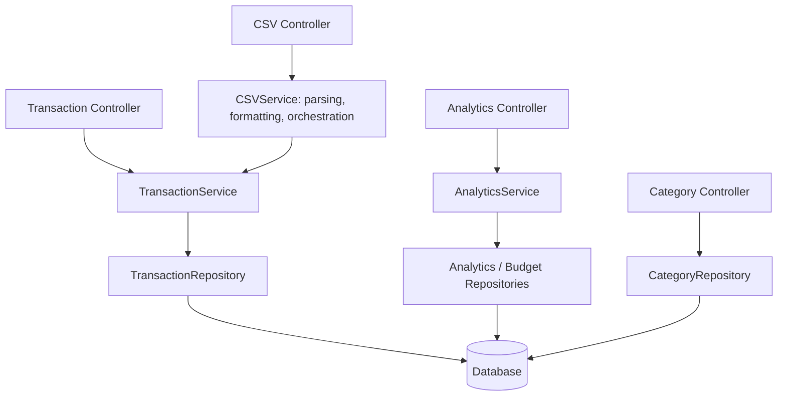
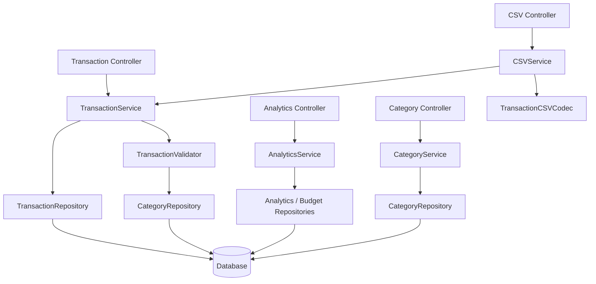

# Assignment 02 — Engineering Implementation Notes

## Before and after architecture

The Assignment 01 code already routed Add Expense and Monthly Budget Summary through services and repositories. The main bypass found during review was category listing, where the route instantiated a repository directly. CSV import/export also combined CSV-format conversion and use-case orchestration in one service.

**Before**

**After**

The refactored feature paths include Add Expense (validation separated from use-case orchestration) and CSV import/export (format conversion separated from application orchestration). Category listing was additionally corrected to follow Controller → Service → Repository → Database. Monthly Budget Summary already followed the required layers in the Assignment 01 baseline and remains on that path.

## Selected rewrites

- `TransactionService` delegates reusable transaction input and category rules to `TransactionValidator`, leaving the service to coordinate transaction use cases and monthly-income policy.
- `CSVService` coordinates import/export through `TransactionCSVCodec`; the codec owns CSV serialization, parsing, header validation, and row conversion.

The CSV wire format remains `type, amount, date, description, category_id`.

## Migration

The migration path is SQLite to PostgreSQL. Local development continues to default to SQLite; Docker Compose provisions PostgreSQL 17. The migration utility requires an empty destination, copies mapped tables in SQLAlchemy dependency order, preserves primary keys, resets PostgreSQL serial sequences, and leaves the SQLite source unchanged.

Run a migration with PostgreSQL available:

1. Place the existing SQLite database at `./data/expensemate.db`.
2. Start PostgreSQL: `docker compose up -d db`.
3. Run the one-time copy: `docker compose --profile migration run --rm migrate`.
4. Start the application: `docker compose up -d expensemate`.

Do not run the copy against a destination containing application records. Back up both databases before an operational migration.

## Verification

- `pytest -q` runs backend unit, repository, API/system, database-constraint, refactoring, CSV-validation, and migration tests.
- With `TEST_POSTGRES_URL` configured, the PostgreSQL test creates an isolated schema, copies fixture records from SQLite, verifies row counts and identifiers, verifies generated IDs advance beyond migrated IDs, and verifies the PostgreSQL allocation trigger.
- `npm run test:run` runs the frontend regression suite; `npm run build` verifies the production bundle.
- `backend/scripts/maintainability_report.py` compares direct repository imports in router modules and AST decision points in transaction/CSV orchestration classes against the Assignment 01 baseline. The AST indicator is an approximate structural measure, not a formal whole-program complexity score.
- Docker Compose CI builds and starts the application against PostgreSQL, then checks database connectivity and the seeded category endpoint.

The CI workflow's recorded run is the verification evidence; the results are not inferred from the test definitions.
