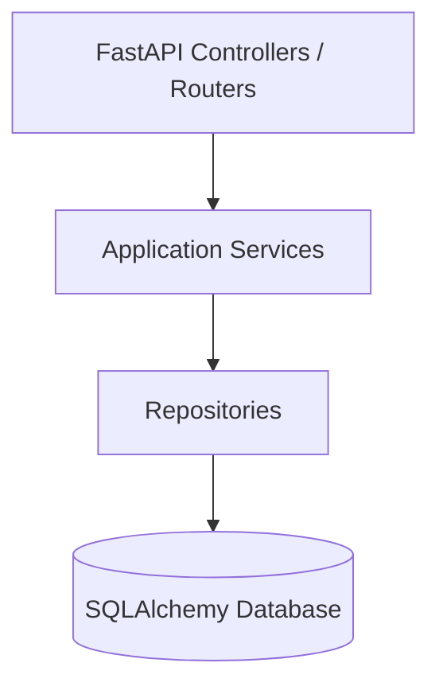

# Assignment 02 — Engineering Implementation Notes

## Layered architecture

The backend follows the required dependency direction:

Transaction endpoints route through `TransactionService`; monthly analytics endpoints route through `AnalyticsService`; category listing routes through `CategoryService`. Repositories own persistence operations while services coordinate transaction, budget, CSV, and validation use cases.

## Selected rewrites

- `TransactionService` delegates reusable transaction input and category rules to `TransactionValidator`, leaving the service to coordinate use cases and monthly-income policy.
- `CSVService` coordinates import/export through `TransactionCSVCodec`; the codec owns CSV serialization, parsing, header validation, and row conversion.

The CSV wire format remains `type, amount, date, description, category_id`.

## Migration

The migration path is SQLite to PostgreSQL. Local development continues to default to SQLite; Docker Compose provisions PostgreSQL 17. The migration utility requires an empty destination, copies mapped tables in SQLAlchemy dependency order, preserves primary keys, resets PostgreSQL serial sequences, and leaves the SQLite source unchanged.

Run a migration with PostgreSQL available:

1. Place the existing SQLite database at `./data/expensemate.db`.
2. Start PostgreSQL: `docker compose up -d db`.
3. Run the one-time copy: `docker compose --profile migration run --rm migrate`.
4. Start the application: `docker compose up -d expensemate`.

Do not run the copy against a destination containing application records. Back up both databases before an operational migration.

## Verification

- `pytest -q` runs backend unit, repository, API/system, database-constraint, refactoring, CSV-validation, and migration tests.
- When `TEST_POSTGRES_URL` is configured, the PostgreSQL migration test creates an isolated schema, copies fixture records from SQLite, verifies row counts and identifiers, verifies generated IDs advance beyond migrated IDs, and verifies the PostgreSQL allocation trigger.
- `npm run test:run` runs the frontend regression suite; `npm run build` verifies the production bundle.
- `backend/scripts/maintainability_report.py` compares direct repository imports in router modules and AST decision points in transaction/CSV orchestration classes against the Assignment 01 baseline. The AST indicator is an approximate structural measure, not a formal whole-program complexity score.

GitHub Actions runs the checks on pushes and pull requests for the configured branches. Actual results are available in the corresponding workflow run.
